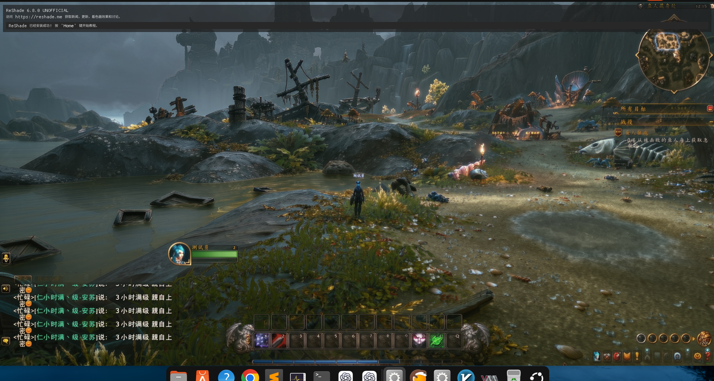
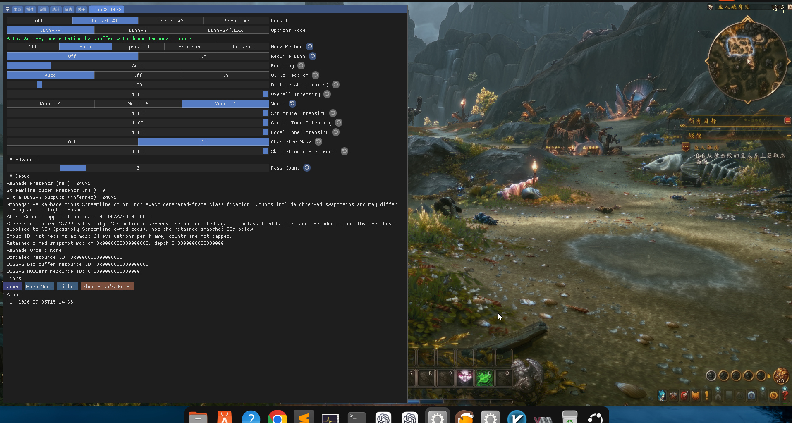

<p align="center">
  
</p>

<h1 align="center">DLSS 5 Swapper</h1>

<p align="center">
  Install and manage DLSS 5 Neural Rendering for compatible games and emulators.
</p>

<p align="center">
  <a href="https://github.com/rakanki911/DLSS5-Swapper/releases/latest"></a>
  <a href="https://github.com/rakanki911/DLSS5-Swapper/releases"></a>
  
  
  <a href="https://buymeacoffee.com/rakanki911"></a>
  <a href="https://buymeacoffee.com/rakanki911"></a>
</p>

## Linux + Lutris：WoW 实测、配置与排错记录

本 fork 增加 Linux/Lutris 前缀接入。本节记录 2026-09-27 至 2026-10-01 在 Ubuntu 上运行《魔兽世界》正式服的完整排查过程。**最终可用路线为 ShortFuse RenoDX DLSS Tool（multipass）+ ReShade PR #435 的修复构建，不是 Feeder 路线。** 这是第三方实验性注入，不是暴雪提供的原生 DLSS 5 开关，也不是对所有游戏、显卡和 Wine 版本的兼容保证。

### 验证边界与版本

| 项目 | 本机实测记录 |
| --- | --- |
| 系统 | Ubuntu 26.04，内核 7.0.0-34-generic |
| GPU / Linux 驱动 | NVIDIA RTX 5070 Ti / 610.43.02 |
| 启动方式 | Lutris → Battle.net → WoW，GE-Proton11-7-x86_64 / UMU |
| 游戏 | Windows x64 正式服，DirectX 12，SDR；成功日志中的缓冲区为 1920×977 |
| Swapper 实测基线 | 本地修改的 2.2.7；本次代码移植保留目标仓库已有的 2.2.9 更新 |
| 最终 ReShade | PR #435 作者提供的 proxy 修复构建；日志版本 `6.8.0.4`，界面可能显示 `6.8.0 UNOFFICIAL` |
| 神经渲染插件 | `renodx-dlss.addon64`，ShortFuse DLSS Tool，面板 Build `2026-09-05T15:14:38` |
| 模型 DLL | `nvngx_dlss.dll` / `nvngx_dlssnr.dll` 310.8.0.0 |
| 最初稳定验证 | Model A、单次处理；日志至少 3,901 次 EvaluateFeature 成功，用户确认正常 |
| 后续用户截图 | Model C、Pass Count 3，正常场景和配置见下图；不是严格的同场景画质或性能基准 |

**2.2.9 代码移植不等于其最新下载的所有插件都已在 WoW 中重测。** 实测运行时、依赖与配置应一同记录；不要把“更新所有组件”当作通用修复。未做长时间压力测试、逐像素质量验证或其他显卡验证，也未在此过程中降级驱动或切换系统。

### 本 fork 改了什么

- 手动添加的游戏如果位于已有 Lutris Wine 前缀的真实 `drive_c` 内，会读取 `$XDG_DATA_HOME/lutris/games/*.yml`（默认 `~/.local/share/lutris/games`），识别前缀和运行器。
- `wine.version: ge-proton` 使用 Lutris 的 `runtime/umu/umu-run`，回退候选为 `/usr/bin/umu-run`；沿用配置中的环境变量，默认 `PROTONPATH=GE-Proton`、`GAMEID=umu-default`、`WINEARCH=win64`。这与本机 Lutris 配置一致，但 GE-Proton 别名可能随 UMU 更新解析到新版本，并非版本锁定。
- 支持配置明确的普通 Wine、system Wine 和 custom Wine；不支持的 custom Proton、缺失运行器和互相冲突的前缀配置会报错，不会静默改用另一套 Wine。
- Windows ReShade 安装辅助程序在匹配的前缀中运行；Steam Proton 的已有路径保留。辅助进程结束后清理超时计时器。
- Linux 安装/还原前检查 `/proc` 中的进程名与 Windows 可执行文件名。不能使用 Windows 的“EXE 可写即未运行”判断，因为 Wine 下它不可靠。同名游戏可能被保守阻止；这不是任意 Wine 布局的完整进程探测器。
- 手动添加 `_retail_` 且存在 `Wow.exe` 的 Lutris 条目显示为 `World of Warcraft`，避免以 `_retail_` 搜索而误配到其他游戏。

当前不支持 Flatpak Lutris 的全部布局、位于前缀外的游戏、Lutris 全局配置继承的完整合并，以及所有自定义运行器。游戏仍由 Lutris/战网启动，Swapper 不是新的游戏启动器。

### 编译与 Electron 启动失败

本机使用 Node.js 20.19.0、npm 10.8.2 和 Electron 33.4.11 编译 2.2.7。**当前 2.2.9 的 electron-builder 依赖要求 Node.js ≥22.12.0，重新打包应使用满足此要求的 Node。** 本次单元测试仍在 Node 20.19.0 上运行，依赖安装有 engine 警告，没有把它当作当前打包验证。源码编译成功仅证明 Electron 应用能生成，不代表 Windows 插件兼容 Linux。

```bash
npm ci
npm run payload
npm run build:linux
```

`payload` 下载/收集第三方资源，按当前版本的输出确认资源齐全；离线或资源不可用时不能只复制一个空 payload 来绕过检查。模型、插件二进制、SDK、Wine 前缀、实验缓存、完整日志和本机备份没有随此提交上传。源代码构建与第三方资源下载是不同步骤。

遇到点击桌面图标即退出、SIGTRAP 或 `SUID sandbox helper ... not configured correctly` 时，检查 deb 安装目录中的 `chrome-sandbox`。本机文件归属 root，但权限为 `0755`；Ubuntu AppArmor 对非特权用户命名空间的限制使桌面启动无法使用该回退。安装脚本以管理员身份测试 `unshare` 成功，并不证明桌面用户具有相同能力。

本机针对已经确认可信、root 所有且普通用户不可修改的安装目录，执行了：

```bash
stat -c '%a %U:%G %n' '/opt/DLSS 5 Swapper/chrome-sandbox'
sudo chown root:root '/opt/DLSS 5 Swapper/chrome-sandbox'
sudo chmod 4755 '/opt/DLSS 5 Swapper/chrome-sandbox'
```

这是为该辅助程序启用 setuid 回退，不是关闭系统 AppArmor，也没有使用 `--no-sandbox`。不要对用户可写的下载目录照搬 setuid 操作。覆盖安装可能重置权限；每次升级后重新检查。此前 Xvfb/隔离配置的冒烟测试未覆盖实际桌面用户的权限环境，因此没有提前发现此问题。

### 添加 Lutris WoW

1. 在 Lutris 配置里确认 Battle.net 的 Wine prefix 和运行器，先通过战网启动一次 WoW。
2. 在 Swapper 点“添加游戏”，选择**包含 `Wow.exe` 的 `_retail_` 文件夹**，而不是整个磁盘、战网前缀或 `drive_c`。
3. 例如前缀为 `/path/to/battlenet` 时，选择 `/path/to/battlenet/drive_c/Program Files (x86)/World of Warcraft/_retail_`。
4. 程序匹配现有 Lutris 配置。出现 `errProtonRequired` 时，检查配置是否能读取、游戏是否真的在前缀内、UMU/Wine 是否存在。仅把 Lutris 游戏添加到 Steam 列表不等于建立可用的 Steam Proton 前缀。

### 选择正确的安装路线

| 路线 | 含义与本次结论 |
| --- | --- |
| ReShade + DLSS5-Feeder + 普通 RenoDX | `dlss5-feed.addon64` 与 `renodx-dlss5.addon64`；本次最终不采用 |
| ReShade + RenoDX DLSS Tool（multipass） | `renodx-dlss.addon64`；最终实测路线，无 Feeder |
| 原生 DLSS / OptiScaler | 需要满足对应的游戏原生输入链路条件；当前 WoW 扫描不满足，灰色选项不是 Lutris 路径问题 |
| Linux NR 0.2.2 实验路线 | 曾配合 Feeder/forwarder 跑出图像，但出现模糊、重影和草丛亮度抖动，已退出这条路线 |

`renodx-dlss.addon64` 与 `renodx-dlss5.addon64` **不是同一个插件**。不要把 Feeder、普通 RenoDX、ShortFuse multipass 和 Linux NR 同时加载。切换路线使用 Swapper 的备份/还原机制；游戏必须退出后才能更换 DLL。此前的 F10 开关属于 Linux NR 实验插件，不能假设它能关闭当前 ShortFuse 路线。

### multipass 的依赖缺口

上游 [issue #239](https://github.com/rakanki911/DLSS5-Swapper/issues/239) 中维护者确认，旧版会漏复制 Streamline，使无原生 DLSS 的游戏只显示菜单却不处理图像。本机在 2.2.7 上补入以下同一资源包中的文件，并全部纳入恢复清单：

```text
sl.interposer.dll    sl.common.dll       sl.dlss.dll
sl.dlss_nr.dll       sl.dlss_g.dll       sl.nis.dll
sl.pcl.dll           sl.reflex.dll       nvngx_dlssg.dll
```

目标仓库 2.2.9 已包含 multipass 的 Streamline 复制逻辑，本 fork 保留该修复；不要重复覆盖游戏本身的 Streamline。复制 DLSS-G 依赖不代表启用插帧，本次成功路径验证的是 NR。最终日志使用 direct NGX 路径，不能把补依赖单独视为黑屏修复的充分条件。

### 黑屏的关键对照：ReShade / VKD3D

1. 标准 ReShade `6.8.0.2155` 下，`Hook Method=Off` 正常；切 `Present` 后游戏画面黑，但菜单可见。
2. 同一轮日志已出现 `Init_Ext succeeded`、`CreateFeature(Reserved18) succeeded`、`EvaluateFeature succeeded`，次数超过 1,400。**API 返回成功不证明输出像素正确。**
3. 保持 ShortFuse 插件、模型和配置不变，只替换游戏旁的 `dxgi.dll` 为 [ReShade PR #435](https://github.com/crosire/reshade/pull/435) 作者的 proxy 修复构建。
4. 重启后日志版本 `6.8.0.4`；用户确认 `Present` 不黑屏，`Require DLSS` On/Off 均不黑屏。随后 Auto + Require DLSS Off 也正常，执行计数至少 3,901。

该 PR 涉及 VKD3D 原生对象/描述符的代理处理。上述单文件对照支持“ReShade 兼容修复解决了本机黑输出”，但没有对本轮 multipass 做底层逐像素根因证明，不应扩展为所有 Linux 黑屏的通解。

实测附件为 **2026-09-11 的 proxy 构建**，不是较早的 validation 构建，也不是 ReShade 官方稳定发布。它来自 PR 作者附件，本项目没有声称能由公开提交完全复现该二进制：

- [作者附件 ReShade64.zip](https://github.com/user-attachments/files/32090311/ReShade64.zip)
- ZIP SHA-256：`789d82f4151abf19ee1329723be4ff3fb4a328713a677191718b4269bf172105`
- 解压 `ReShade64.dll` SHA-256：`2f035e5dde2a483d3123abab4944b400e5c56969a6f77f8396c9617d29fe537d`

仅在确认来源、哈希并退出游戏后替换。仓库提供本次操作的通用版本，要求已有 Swapper multipass 活动清单，备份旧 ReShade、配置和日志，校验上述固定哈希，事务中只替换 `dxgi.dll`：

```bash
node scripts/install-linux-reshade-proxy.cjs \
  '/path/to/World of Warcraft/_retail_' \
  '/path/to/verified/ReShade64.dll'
```

此脚本不下载、不编译修复 DLL，不改变驱动、运行器、模型或游戏 EXE。下一次启动先保持 Off，确认原画面，再开启 Present 验证；成功后可用 Auto。Swapper 后续升级/重装 ReShade 可能覆盖这个实验构建，发生回归时先核对哈希。

### 最终界面配置和截图

初次验证使用 Model A / Pass Count 1。用户后来提供的截图是 **Model C / Pass Count 3**，请区分这两个阶段。多次处理会增加 GPU 成本，截图显示约 29 FPS，不能用它证明帧率改善。

| 控件 | 用户截图值 |
| --- | --- |
| Preset / Options Mode | Preset #1 / DLSS-NR |
| Hook Method | Auto，状态 `Auto: Active, presentation backbuffer with dummy temporal inputs` |
| Require DLSS | Off |
| Encoding / UI Correction | Auto / Auto |
| Diffuse White | 100 nits（覆盖开关未开启） |
| Overall Intensity | 1.00 |
| Model | C |
| Structure / Global Tone / Local Tone | 各 1.00 |
| Character Mask / Skin Structure Strength | On / 1.00 |
| Pass Count | 3；首次排错建议从 1 开始 |

WoW 没有供这个插件使用的原生 DLSS 链路，因此 `Require DLSS=On` 可能等待原生输入而不处理图像。`Hook Method=Off` 明确关闭效果；`Preset #1` 和选择 `DLSS-NR` 页面本身并不等于开启 Hook。视频中即使选了 Model C、Pass Count 2，状态仍是 `Auto: Waiting` 也不能认定已生效。

**用户提供的游戏画面：**



**同次提供的 multipass 配置：**



图片由用户明确授权上传，未经修改；不是经过固定相机、曝光与帧率控制的 A/B 对比。

### 如何判读日志，而不是只看红黄文字

| 日志或现象 | 本次判断 / 处理 |
| --- | --- |
| `attach-dred-settings ... hr=0x887A002D` | DRED 调试诊断设置失败。成功轮次中仍出现，不应单独作为 NR 执行失败的证据 |
| `NVNGX parameter module is not loaded yet: nvngx.dll` | 启动早期模块未加载。后续检查 NGX hooks、Init_Ext，而不是仅按此行判断缺文件 |
| `Streamline interposer not found: sl.interposer.dll` | 先核对部署，再核对是否加载。最终 direct NGX 成功路径仍出现这条早期信息；不需要为了消除 WARN 盲目混装 DLL |
| `PlatformError 0xBAD00002` + `FeatureNotSupported 0xBAD00001` + Feeder `stopped` | 旧 Feeder 轮次确实停止初始化。其“覆盖层或反作弊阻挡”的文字是插件推测，不是已证实的根因 |
| `Successfully compiled ... with warnings`，X4000 / X3556 | 编译成功但有潜在未初始化变量或整数运算性能警告，不等于本次初始化失败，也不保证着色器无问题 |
| `Lumenite_Kernel DISABLED` / provider 不匹配 | 仅适用于 Feeder：provider=3 对应 Kernel，需启用并排在 Feed 前；vort 对应 provider=2。不能只勾选另一个运动向量效果 |
| `Auto: Waiting` / `Off: Disabled` | 分别表示等待条件或关闭，先确认 Hook 和 Require DLSS |
| 成功轮次仍有 `DLAA/SR 0`、`RR 0`、资源 ID 0、Streamline Presents 0 | 面板这些计数描述原生 SR/RR、Streamline 或保留的时序资源；本例使用 backbuffer + dummy temporal inputs。以 direct NR 的 Create/Evaluate 日志和实际图像共同判断 |
| `Extra DLSS-G outputs (inferred)` 增长 | 面板明确说这是推算计数，不能证明已开启插帧 |
| `Driver 999.99` 或类似异常版本字符串 | Wine/DXGI 的报告不等于 Linux 驱动版本，用 `nvidia-smi` 记录真实驱动 |

实际成功日志摘要（保留原字段，省略地址）：

```text
Initializing crosire's ReShade version '6.8.0.4'
NGX parameter acquisition hooks active 6/6
backend-owned NVIDIA NGX core initialization succeeded
Init_Ext succeeded
CreateFeature(Reserved18) succeeded
EvaluateFeature succeeded: evaluation=3901 ... result=0x00000001
source evaluation completed ... replace_source=true return_output=false
```

### 尝试过但未作为最终方案保留的路径

- Feeder 0.15.1 初期遇到 D3D11 多线程保护误停；根据上游 #96 更新到 1.17.0 后曾有执行成功记录，但用户随后反馈黑屏。不能仅因版本新或一次成功记录就再次升级。本轮误重试升级已撤销，三个文件及安装清单按备份恢复，最终 multipass 路线完全移除了 Feeder。
- Feeder + Linux NR 0.2.2 + 匹配模型曾先黑屏；像素诊断显示 DLAA 输入非黑、输出全零。ReShade proxy 修复后这条路线能够输出图像，但用户反馈文字重影、模糊、移动草丛时亮度抖动，关闭 NR 后消失。这些是独立的画质/时序问题，不是“调用成功”就解决了。
- 实验性 SDR FP16 桥接触发 CreateFeature 访问异常，已回退，未包含在最终组合。不要重新启用该实验构建。
- DX11 冷启动曾在 nvapi64 路径崩溃；恢复 DX12。不能把“切 DX11”列为本机已验证修复。
- 调分辨率时曾因未及时确认而自动回退；记录实际 swapchain 尺寸，不能只记录打算选择的分辨率。最终成功日志是 1920×977，不应写成“已经验证原生 1080p/4K”。
- 旧实验曾完整卸载并恢复正常启动；后来用户重新授权测试才安装当前路线。历史日志里的 Linux NR/F10、Feeder 调参不属于当前 ShortFuse 配置。
- 多次构建/覆盖安装可能装到旧产物。本次发布以源码测试为准；部署时应比较安装目录 `resources/app.asar` 与实际打包产物，而不只看应用版本号。本次未发布新的 Linux 二进制 release。

### 回退与复现纪律

出现黑屏先将 Hook Method 切回 Off；本机两条相关对照均能恢复画面。若界面无响应再正常退出或 Alt+F4。不要在游戏运行时覆盖 DLL，也不要把改磁盘 INI 当作已确认运行时生效。

Swapper 使用游戏旁 `_DLSS5_Backup/manifest.json` 记录新增/替换文件。退出游戏后使用“恢复原始文件”；保留该目录及真实原文件备份，不要递归删除整个游戏目录，也不要删除游戏原带的 DLL。修复脚本另外把替换前的文件放在它输出的快照目录里。每次修改只改变一个可解释因素，并保留可回退的配置、组件版本和日志。

这次测试没有更改 WoW.exe；替换过程逐次校验其哈希保持不变。正常启动、API 调用成功、画面正常、画质改善与长时间稳定是不同验证层级。本次证据到“用户确认画面正常且日志有实际 NR 执行”，不宣称官方支持、无画质瑕疵或账号兼容保证。

### 开发验证

```bash
node --test test/linux-proton.test.js test/linux-lutris.test.js \
  test/multipass.test.js test/backend-journal.test.js \
  test/apply-failed-restore.test.js test/install-routes.test.js
npm test
```

前缀测试覆盖空格路径、符号链接越界、缺失/冲突运行器、环境/参数传递和运行中游戏拦截。文件事务测试不能替代 Wine/GPU 实测。原始 2.2.7 构建记录曾有 6 项全量单元测试失败及 UI 冒烟失败，不将它们包装成“全部通过”。

本次移植在相同 Node/Linux 环境下对照：未修改的目标基线 `9fb0b7c` 为 301 pass / 6 fail / 2 skip；合入后为 305 pass / 6 fail / 2 skip，新增 4 项 Lutris 测试全部通过。失败项名称相同，涉及 API override IPC、篡改 profile 路径保护、history IPC、两项 payload 提示与旧 shader compiler 恢复。未在本提交扩大范围修复这些原有问题，也未重新跑游戏来验证 2.2.9 的完整资源包。

## Download

[**Windows Installer**](https://github.com/rakanki911/DLSS5-Swapper/releases/latest) ·
[**Portable**](https://github.com/rakanki911/DLSS5-Swapper/releases/latest) ·
[Checksums](https://github.com/rakanki911/DLSS5-Swapper/releases/latest)

Both are on the latest release page, with `SHA256SUMS.txt` beside them.

<p align="center">
  
</p>

## Features

- **Easy installation:** native DLSS games, or compatible non-DLSS games through DLSS5-Feeder.
- **Your library:** Steam, Epic, GOG, modern Xbox Game Pass folders, and manually added games/emulators.
- **Search and filters:** combine title, graphics API, DLSS status/version and add-ons; click counters to filter.
- **Flexible layout:** group by store or show everything in one list, with game artwork and light/dark themes.
- **Controlled scanning:** full-drive scanning is **off by default**. Added folders still scan normally; enable all-drive discovery or remove scan folders in Settings.
- **Right-click shortcuts:** open/copy folder, rescan, change cover, restore originals or hide a game.
- **Backups and History:** restore original files, keep installation records, and copy History/activity/install logs.
- **Save diagnostics:** one file with the install log, the game’s own ReShade and Feeder logs, the manifest and your driver - shown to you before it is written, and ready to attach to a report.
- **In-game overlay:** press **F8** to open the app's own panel over the running game and move the real DLSS Neural Rendering sliders while you play. Supports the **DLSS5-Feeder** and **RenoDX** routes only, and it knows both RenoDX builds the app ships (6.5.3 and the older 4.7). Drag the grip in its bottom right corner to resize it; each game remembers its own size.
- **Rendering API override:** optional, per game, with **Automatic** as the default; detection is never overwritten.
- **Custom add-ons:** the Add-ons page remains available alongside the integrated installation routes.
- **Multipass neural rendering:** an installation route that runs the neural pass up to ten times per frame, on DX12, DX11 and 64-bit DX9 - including games with no DLSS of their own.
- **Community (BETA):** read what worked for other people, narrowed to the games on your PC and the graphics card in it, leave your own report, and talk it over underneath it. Opt-in, and everything you leave can be edited, deleted or withdrawn.
- **Community chat:** one live room for everyone using the app - screenshots, game cards, replies with mentions and reactions.

## New in 2.2.9

Four faults from the tracker, fixed at the cause. Every one of them was reported by somebody in it.

| | |
|---|---|
| **The installer crashed before it opened** | On some machines the setup died instantly with `0xc0000005`, no window and no prompt, while the portable build was fine. The installer framework read past the end of a path Windows handed it. Fixed upstream, and this release is built with the fixed version ([#344]) |
| **Restore originals went dead with the files still in the game** | A finished restore renames the backup record aside, and everything that decides whether a game has anything installed read only the live one. The app now offers the newest retired record whose files are still in the game, and restores from the same backups ([#325]) |
| **dgVoodoo2 flagged by antivirus** | Upstream released 2.87.5 precisely because engines flag 2.87.4, and the app was pinned to 2.87.4 ([#390]) |
| **ReShade never started in a wrapped DirectX 8/9 game** | Inside dgVoodoo the game is a DirectX 11 one, and some setups load only `d3d11.dll`. The **ReShade file** choice is offered for these games now ([#343], [#374]) |

[#325]: https://github.com/rakanki911/DLSS5-Swapper/issues/325
[#343]: https://github.com/rakanki911/DLSS5-Swapper/issues/343
[#344]: https://github.com/rakanki911/DLSS5-Swapper/issues/344
[#374]: https://github.com/rakanki911/DLSS5-Swapper/issues/374
[#390]: https://github.com/rakanki911/DLSS5-Swapper/issues/390

## Earlier releases

Each one is written up in full - what broke, why, and what was changed.

| | |
|---|---|
| **2.2.8** | [A second theme, and every add-on brought current](docs/releases/v2.2.8.md) - a whole second design, DLSS5-Feeder 1.17.0, RenoDX 6.5.3, a second OptiScaler build per game, and ten faults fixed |
| **2.2.7** | [Find the reviews that matter to you](docs/releases/v2.2.7.md) - filter by your card, reviews for your games, notifications, and eight faults fixed |
| **2.2.6** | [Community chat](docs/releases/v2.2.6.md) - one live room for everyone, and the right add-on on every route |
| **2.2.5** | [Multipass](docs/releases/v2.2.5.md) - the neural pass up to ten times per frame, plus nine faults fixed at the cause |
| **2.2.4** | [The Community page](docs/releases/v2.2.4.md) - compare notes with everyone else, plus eight faults fixed at the cause |
| **2.2.3** | [Six reported faults, fixed at the cause](docs/releases/v2.2.3.md) - OptiScaler on older cards, a game's own stale shader compiler, the overlay on a scaled display |
| **2.2.2** | [The reports people sent](docs/releases/v2.2.2.md) - games it could not find, installs it refused, the overlay's own page |
| **2.2.1** | [The Overlay page](docs/releases/v2.2.1.md) - themes you can write yourself, and a preview that runs before you choose |
| **2.2.0** | [Optional OptiScaler and a smarter library](docs/releases/v2.2.0.md) |

Every release also carries its own notes and downloads on the
[releases page](https://github.com/rakanki911/DLSS5-Swapper/releases).

## Compatibility

| Category | Support |
| --- | --- |
| **System** | Windows 10/11 x64; compatible 32-bit and 64-bit games |
| **ReShade / Feeder GPUs** | RTX 20 / 30 / 40 / 50; older-series support is reported by the bundled modified runtime's author |
| **OptiScaler GPUs** | 64-bit games with native DLSS enabled. The bundled neural model runs on **Blackwell** (RTX 50 / RTX PRO Blackwell); an older card needs a modded `nvngx_dlssnr.dll` you supply, which is never overwritten. Driver **616.56** or newer |
| **DirectX 12** | Native DLSS, Feeder, or eligible OptiScaler games |
| **DirectX 11** | Feeder for 32/64-bit games; eligible OptiScaler games |
| **DirectX 9 / 8** | DX9: 32/64-bit; DX8: 32-bit, through dgVoodoo2 → DX11 → Feeder |
| **Vulkan / OpenGL** | ReShade/Feeder; eligible Vulkan games can also use OptiScaler |
| **DirectX 10** | Not directly supported by Feeder; choose DX11 when available |
| **In-game overlay** | 64-bit DirectX 11 / 12 games with ReShade add-on support; **DLSS5-Feeder and RenoDX only** |

OptiScaler's DX11/Vulkan path uses a DX12 bridge with FSR output by default.
For Vulkan backend changes, **restore originals first**. OptiScaler is not the emulator/non-DLSS route.

## Emulators

Select the emulator folder and its active renderer, then use **ReShade/Feeder**.

<table>
  <tr><th colspan="3">Emulators</th></tr>
  <tr><td>DuckStation</td><td>PCSX2</td><td>RPCS3</td></tr>
  <tr><td>Dolphin</td><td>PPSSPP</td><td>Xenia</td></tr>
  <tr><td>Cemu</td><td>Ryujinx</td><td>yuzu / suyu / Eden / Citron / Sudachi</td></tr>
  <tr><td>shadPS4</td><td>Azahar / Citra / Lime3DS</td><td>melonDS</td></tr>
  <tr><td>Flycast</td><td>xemu</td><td>Vita3K</td></tr>
  <tr><td>RetroArch</td><td>mGBA</td><td>Snes9x</td></tr>
  <tr><td>Play!</td><td></td><td></td></tr>
</table>

Compatibility varies by renderer and game. Xenia HUD correction remains experimental.

## 38 languages

<table>
  <tr><th colspan="4">All 38 languages</th></tr>
  <tr><td>English</td><td>العربية</td><td>简体中文</td><td>繁體中文</td></tr>
  <tr><td>Español</td><td>Português</td><td>Русский</td><td>Deutsch</td></tr>
  <tr><td>Français</td><td>日本語</td><td>한국어</td><td>Italiano</td></tr>
  <tr><td>Türkçe</td><td>Polski</td><td>Українська</td><td>Nederlands</td></tr>
  <tr><td>Čeština</td><td>Magyar</td><td>Română</td><td>Ελληνικά</td></tr>
  <tr><td>Svenska</td><td>Dansk</td><td>Norsk</td><td>Suomi</td></tr>
  <tr><td>ไทย</td><td>Tiếng Việt</td><td>Bahasa Indonesia</td><td>Bahasa Melayu</td></tr>
  <tr><td>Filipino</td><td>हिन्दी</td><td>বাংলা</td><td>فارسی</td></tr>
  <tr><td>اردو</td><td>Български</td><td>Српски</td><td>Hrvatski</td></tr>
  <tr><td>Slovenčina</td><td>Català</td><td></td><td></td></tr>
</table>

**Arabic, Persian and Urdu support right-to-left layout.**

## Screenshots

<p></p>
<p></p>
<p></p>
<p></p>

## Before installing

- **Anti-cheat:** red warning and optional confirmation, not a blanket block. Injection can cause crashes or account bans; the app never bypasses anti-cheat.
- **Requirements:** Feeder needs Visual C++ runtimes (x64, plus x86 for 32-bit games). Some components download on first use.
- **Compatibility is not guaranteed.** Keep backups; existing mods may conflict. Not every reported game crash is fixed.
- **Linux/Proton:** experimental community source only; no Linux binaries in this release.

## Community and privacy

- Opening the Community page downloads public game reports. A live connection
  count is held only in memory; no connection identifiers are stored.
- A report is sent only after you review and submit the fields shown in its
  dialog: game, route, rendering API, result, optional comment, GPU, driver,
  CPU, OS and app version.
- The app uses a random install ID to prevent duplicate votes. The server stores
  only its hash. **Remove my community activity** hides all your reports and
  replies and resets your public community profile.
- The owner-only administrator access code is verified by the community server
  and stored locally with Windows encrypted storage. It is never written to the
  public profile or the normal community settings file.

## Support

DLSS 5 Swapper is free and MIT licensed. If it saved you an evening of
fiddling, you can buy me a coffee.

<p><a href="https://buymeacoffee.com/rakanki911"></a></p>

---

Built by **Rakan Alkhaldi** · MIT · [Third-party credits and licences](THIRD_PARTY_NOTICES.md)
